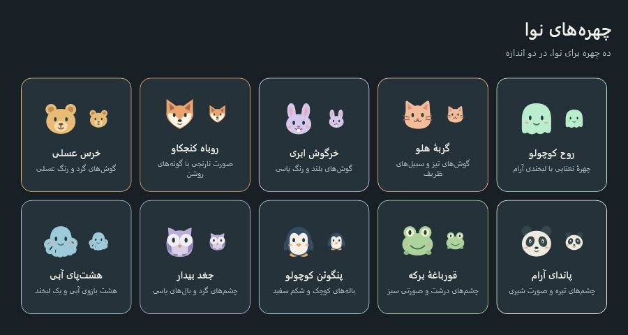

# نوا · Nava

**تو بگو، من می‌نویسم.**

نوا حرف‌هایت را به فارسی و انگلیسی، هم‌زمان به متن تبدیل می‌کند. میانبر را نگه دار و صحبت کن؛ برای پایان رها کن. وقتی پنجره جمع است، فقط چهرهٔ کوچکی روی صفحه می‌ماند.



## نصب و شروع

از [آخرین نسخه](https://github.com/kpasargad/nava/releases/latest)، فایل `Nava-Setup-1.0.4-win-x64.exe` را دریافت و اجرا کن. نصب برای حساب فعلی ویندوز انجام می‌شود؛ به دسترسی مدیر یا نصب جداگانهٔ .NET نیاز نداری. نوا برای Windows 10/11، نسخهٔ ۶۴ بیتی است.

در اولین اجرا، آدرس سرویس تبدیل گفتار و کلید دسترسی خودت را در تنظیمات وارد کن. سرویس یا کلید خصوصی در برنامه قرار نگرفته است.

نسخهٔ Portable هم در همان صفحه است. فایل ZIP را باز کن و `Nava.exe` را اجرا کن. نصب‌کننده امضای دیجیتال ندارد؛ فایل `SHA256SUMS.txt` برای بررسی یکسان‌بودن فایل دانلودشده با نسخهٔ منتشرشده در دسترس است.

## استفاده

1. **NumLock را نگه دار و صحبت کن.** برای پایان، رها کن. میانبر را می‌توانی از تنظیمات عوض کنی.
2. متن هنگام صحبت ظاهر می‌شود. بخش موقت آن ممکن است با ادامهٔ صحبت تغییر کند. متن نهایی به‌طور پیش‌فرض کپی می‌شود؛ با Ctrl+V آن را بچسبان.
3. برای بازکردن پنجره روی چهرهٔ نوا کلیک کن؛ برای جابه‌جایی آن را بکش. پنجره پس از ضبط جمع می‌شود و هنگام خواندن با ماوس باز می‌ماند.
4. از تنظیمات، یکی از **۱۰ چهره** را انتخاب کن. انتخابت همان لحظه ذخیره می‌شود.
5. از **یادداشت‌ها** متن را بخوان، ویرایش کن، گوینده‌ها را نام‌گذاری کن یا فایل TXT، SRT و JSON بگیر. برای صدای آماده، **تبدیل فایل** را بزن.

دکمهٔ «نگه دار و صحبت کن» با ماوس، Space و Enter هم کار می‌کند. صدای کوتاه شروع و پایان را می‌توانی از تنظیمات خاموش کنی.

نوا در Alt+Tab و نوار وظیفه ظاهر نمی‌شود. پنجرهٔ یادداشت‌ها و تنظیمات را از چهرهٔ کوچک یا آیکن کنار ساعت باز کن. برای بازکردن مستقیم هم این دستورها در دسترس‌اند:

```powershell
& "$env:LOCALAPPDATA\Programs\Nava\Nava.exe" --settings
& "$env:LOCALAPPDATA\Programs\Nava\Nava.exe" --history
```

## اتصال و قابلیت‌ها

نوا صدا را برای تبدیل به سرویس انتخاب‌شده می‌فرستد؛ برای تبدیل گفتار به اتصال شبکه نیاز داری. فارسی، انگلیسی و تشخیص گوینده‌ها در متن پشتیبانی می‌شوند. خلاصه‌سازی، فهرست کارها و مرتب‌کردن متن به امکانات اتصال تو بستگی دارند؛ اگر در دسترس نباشند، نوا همان‌جا توضیح می‌دهد.

پروکسی پشتیبان اختیاری است. فقط درخواست ناموفق همین سرویس با آن تکرار می‌شود و پروکسی ویندوز تغییر نمی‌کند.

## داده‌های تو

- نسخهٔ نصب‌شده داده‌ها را در `%LOCALAPPDATA%\Nava` نگه می‌دارد. در نسخهٔ Portable، پوشهٔ `Data` کنار برنامه است.
- کلید و اطلاعات پروکسی با حساب ویندوزت رمزگذاری می‌شوند. متن و صدای یادداشت‌ها فایل‌های محلی‌اند؛ پوشهٔ داده‌ها را عمومی منتشر نکن.
- نگهداری صدای ضبط‌شده پس از تبدیل اختیاری است. فایل اصلیِ واردشده با حذف یادداشت پاک نمی‌شود.
- حذف یادداشت مربوط به همین دستگاه است. حذف یا به‌روزرسانی برنامه، داده‌های شخصی را پاک نمی‌کند.
- اجرای نوا با ویندوز و چسباندن خودکار متن اختیاری‌اند. چسباندن فقط در پنجرهٔ شروع ضبط و پس از رهاکردن کلیدهای میانبر انجام می‌شود؛ اگر پنجره را عوض کنی، متن فقط کپی می‌شود.

بستهٔ نصب، ZIP و سورس شامل کلید، پروکسی، یادداشت یا صدای شخصی نیستند.

## ساخت

نیاز توسعه: Windows و .NET 10 SDK؛ اسکریپت بسته‌بندی با PowerShell 7 اجرا می‌شود. برنامه وابستگی NuGet خارجی ندارد. همهٔ چهره‌ها برداری و داخل کد برنامه‌اند.

```powershell
dotnet build Tests/Nava.Tests.csproj -c Release
dotnet run --project Tests/Nava.Tests.csproj -c Release --no-build
.\build.ps1
```

برای ساخت نصب‌کننده، [Inno Setup 7 یا 6.3+](https://jrsoftware.org/inno-setup/downloads) را نصب و اجرا کن:

```powershell
.\scripts\package.ps1 -Version 1.0.4 -IsccPath 'C:\path\to\ISCC.exe'
```

این دستور publish مستقل از Runtime را در پوشهٔ تازه می‌سازد، فایل‌های مجاز را جدا می‌کند و نصب‌کننده، Portable ZIP و SHA-256 را در `artifacts/release` قرار می‌دهد. از `dist/Data` یا تنظیمات محلی بسته نمی‌سازد. مجوزهای Runtime و اعلان‌های وابستگی‌ها، با نسخهٔ دقیق موجود در متادیتای restore و publish، در `LICENSE.txt` و `ThirdPartyNotices.txt` قرار می‌گیرند؛ نیازی به مسیر شخصی یا نسخهٔ ثابت در اسکریپت نیست.

جزئیات بررسی در [TESTING](docs/TESTING.md)، [گزارش انتشار](docs/VERIFICATION.md) و [حریم داده و امنیت](SECURITY.md) آمده‌اند.


## سازگاری سرویس برای توسعه

نوا قرارداد نشست `/v1/stt/session` و جریان آپلود فایل را پشتیبانی می‌کند. برای درگاه‌های سازگار با API مستقیم Soniox، وب‌سوکت همان درگاه و جریان `files/model/file_id` تشخیص داده می‌شوند. کلید درگاه به یک وب‌سوکت عمومی دیگر ارسال نمی‌شود. ضبط موفق زنده پس از پایان دوباره به‌صورت batch پردازش نمی‌شود.

متن‌های محصول بر اساس [راهنمای صدای نوا](docs/VOICE.md) نوشته می‌شوند.
